# Border Muse

Consistent framing for photographs, with local processing and a reusable geometry
core. The first app is native macOS; the same geometry can power other apps and
photo editors.



## macOS app

Import photos, preview aspect ratio and thickness, and export a batch while
keeping the originals. Includes saved presets, optional size reduction, JPEG
quality and metadata controls. Supports JPEG, PNG and single-image TIFF,
including 16-bit TIFF. Exports currently use white borders.

Requires macOS 14+. The app is experimental; native interaction, accessibility
and installation validation are still in progress. See [installation](docs/INSTALL.md)
for downloads and signing limitations.

With full Xcode installed:

```bash
bash scripts/macos/test.sh
bash scripts/macos/build.sh
open build/macos/BorderMuse.app
```

## Use the geometry

The geometry core calculates canvas dimensions and symmetric margins without
image decoding, UI or a renderer. It follows measured Lightroom Mobile framing
behavior, with the same numeric conformance cases for every implementation.
Border color does not affect the calculation.

The repository root exposes the `BorderMuseGeometry` Swift library. Start with
[the integration guide](geometry/README.md) and [Swift example](examples/swift-editor).
The Python reference and portable fixtures are also included. Other language
packages will follow real editor integrations.

## Roadmap

- **Now, in parallel:** validate and polish the macOS app; make the first external
  editor integration work with the shared geometry.
- **Next:** improve performance and installation confidence, prepare signed and
  notarized distribution, and stabilize the package API from integration feedback.
- **Later:** additional border colors, watched folders, Finder actions and richer
  CLI workflows; evaluate Windows, iOS and web consumers as needs emerge.

See the [delivery plan](docs/PLAN.md) for concrete steps and completion criteria.
Future platforms and features are directions, not release commitments.

## Repository

- `apps/`: macOS app and developer CLI.
- `packages/`: portable Swift geometry and Apple image rendering.
- `geometry/`: algorithm reference, shared measured fixtures and conformance tests.
- `examples/`: small integrations independent of the macOS app.
- `docs/`: architecture, plan, development, geometry and distribution guidance.
- `scripts/` and `assets/`: build/verification tools and brand artwork.

[Architecture](docs/ARCHITECTURE.md) · [Development](docs/DEVELOPING.md) ·
[Contributing](CONTRIBUTING.md)

Code and original artwork are [MIT licensed](LICENSE).
See [third-party notices](THIRD_PARTY_NOTICES.md).
